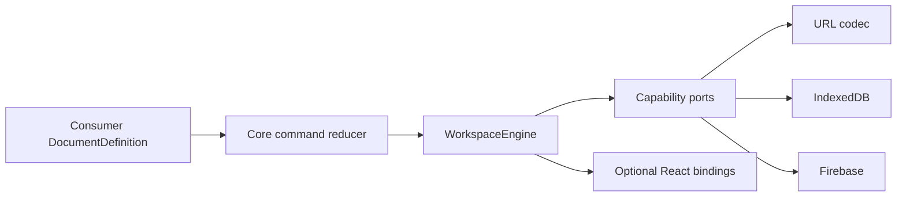

# Architecture

Portable Document Kit separates semantic documents from transports and
providers.

## Invariants

- Untrusted state and commands are validated at every boundary.
- Reducers are deterministic, immutable, and side-effect free.
- Document, snapshot protocol, route, and repository versions evolve
  independently.
- Capabilities are explicit. Provider identity never implies behavior.
- Recoverable route and synchronization failures remain visible state.
- Content, commands, payloads, tokens, and URLs are excluded from diagnostics.
- Provider adapters declare their integrity level instead of overstating it.

The core uses the synchronous subset of Standard Schema because optimistic
reduction must complete before rendering. Asynchronous validation belongs at a
provider or use-case boundary before command dispatch.
