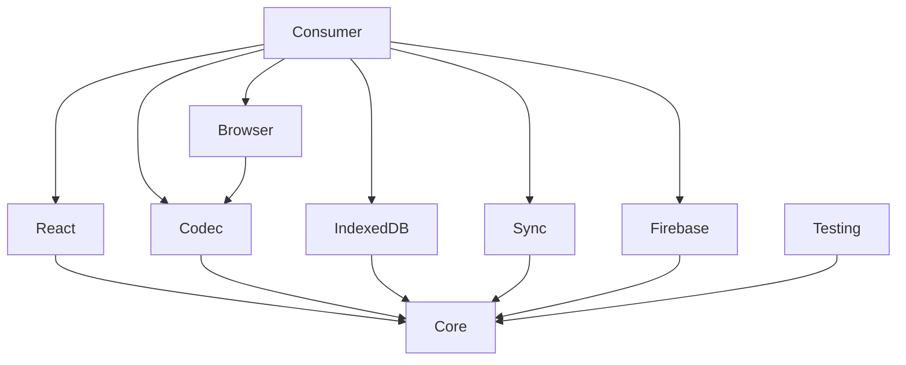

# Package Guide

## Core

Defines document contracts, validation, semantic command application, command envelopes, narrow
capability ports, revision conflicts, diagnostics, and `WorkspaceEngine`. It has no provider,
framework, compression, storage, or browser dependency.

## Codec

Defines portable snapshot envelopes, serializer and compression ports, bounded decoding, migration,
and explicit legacy decoders. Transport protocol version, document schema version, serializer ID,
and route prefix are independent.

## Browser

Contains fragment routing, History API isolation, navigation-write policy, lifecycle subscriptions,
and portable URL creation. Importing the package during SSR does not read browser globals.

## IndexedDB

Implements validated snapshots, catalog listing, revision history, subscriptions, and a durable
outbox. Database construction is explicit, upgrades are transactional, blocked upgrades fail with a
typed error, and records are validated when loaded.

## Sync

Implements revisioned optimistic concurrency. It distinguishes visible optimistic state, durable
pending commands, the in-flight command, acknowledged head state, and conflict or transport failure.
The `ReplicationEngine` interface permits CRDT, OT, peer-to-peer, or server-authoritative engines.

## Firebase

Separates authentication from the fixed Firestore repository model. It provides content commits,
history, publications, membership, invitations, presence, and emulator-tested Rules and indexes. The
adapter declares `envelope-enforced` integrity: Rules validate access and envelope invariants, not
arbitrary consumer domain semantics.

## React

Provides an optional provider and hooks over the headless workspace. It owns no product UI and does
not make persistence or provider decisions.

## Testing

Provides deterministic clocks, in-memory ports, and conformance helpers. Adapter authors should run
the same conformance behavior against every implementation and add provider-specific failure tests.

## Dependency Direction

No package may infer capabilities from an adapter name. Use its `CapabilityManifest`.
